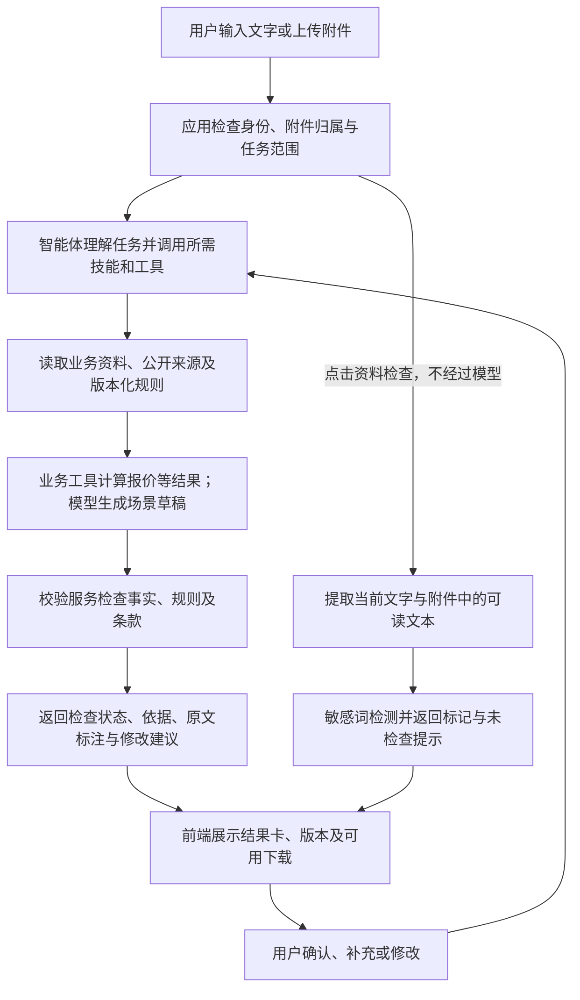
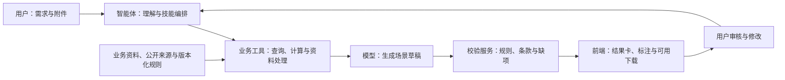

<!-- Modified by foreign-trade-agent contributors: public team distribution. -->
# 外贸业务助手 · foreign-trade-agent

**让外贸业务从零散资料，走向有依据的下一步。**

外贸业务助手通过对话串联八个业务工作流，帮助商家整理客户资料、准备沟通与谈判方案、核对订单、制作商品内容并推进采购。用户提供需求和资料，助手生成业务草稿、指出风险与缺项，并支持继续修改。

**从一个询盘、一份产品表或一个客户官网开始。**

[八个工作流](#workflows) · [第一次使用](#first-use) · [案例演示](#examples) · [评分 Q&A](#scoring) · [快速部署](#quickstart) · [能力边界](#status) · [文档导航](#documents)

## 解决什么问题

| 外贸日常问题 | 助手如何帮助 |
|---|---|
| 客户信息分散，难判断是否值得继续联系 | 整理公开资料、匹配依据及待核实事项，形成背调报告 |
| 英文回复耗时，需求容易问漏 | 根据往来和已确认事实生成场景化草稿，集中追问关键缺项 |
| 报价与交易条件反复修改，容易前后不一致 | 调用业务工具重算，核对版本、金额和条款差异 |
| 同一产品要反复整理不同平台的资料 | 按目标平台组织文案、属性和图片，并检查发布前缺项 |
| 谈单经验留在个人聊天记录里 | 还原过程，区分事实与原因假设，形成改进行动和待审案例 |

## 产品体验

在对话框的 **“+ → 工作流”** 中选择业务任务；提交需求后，助手按依赖调用技能，资料不足时提示补充。输入框的 **“资料检查”** 按钮可直接检查当前文字和所选附件，并在弹窗中标记敏感词。

查看 [完整互动演示](docs/HACKATHON_DEMO.md) 可复现两轮修改、原文风险标注和审核前后对比；[实际验收记录](docs/ACCEPTANCE_20261031.md) 列明真实调用和下载核验结果。

<a id="workflows"></a>

## 八个工作流：什么时候用，能得到什么

| 工作流 | 什么时候用 | 你提供什么 | 助手交付什么 |
|---|---|---|---|
| [获客](docs/ACQUISITION_WORKFLOW.md) | 想找更匹配的潜在买家 | 产品、目标市场、供货能力 | 候选线索、筛选依据、优先级及开发信草稿 |
| [背调](docs/DILIGENCE_WORKFLOW.md) | 接触客户后，判断是否值得推进 | 公司名称、官网、联系人和交易条件 | 身份核验、业务匹配、风险与待核实事项 |
| [沟通](docs/COMMUNICATION_WORKFLOW.md) | 准备开场、回复或跟进 | 往来原文、沟通目标、确认过的产品资料 | 回复草稿、需求追问、跟进建议及纪要 |
| [谈单](docs/NEGOTIATION_WORKFLOW.md) | 客户压价、有异议或要求样品 | 报价、成本、授权范围和客户反馈 | 谈判建议、条件交换方案及样品推进计划 |
| [复盘](docs/RETROSPECTIVE_WORKFLOW.md) | 找出商机卡点，规划下一次改进 | 往来、报价、跟进和订单记录 | 过程时间线、原因分析、改进行动和候选经验 |
| [成交](docs/CLOSING_WORKFLOW.md) | 客户接受方案，准备落实订单 | 最终条款、PO、模板及签署／付款证据 | 条款差异、PI／合同草稿、收款核对及交接清单 |
| [发品准备](docs/LISTING_PREPARATION.md) | 为目标平台整理商品资料 | 规格、授权图片、平台及适用规则 | 商品文案、属性、适配图片及发布前检查结果 |
| [采购](docs/PROCUREMENT_WORKFLOW.md) | 寻找供应商、比价并跟进履约 | 需求、库存、供应商报价及履约记录 | 供应商比较、成本核算、质量／交期风险及对账结果 |

工作流按当前资料与任务触发所需阶段，不要求一次填完所有信息。对外文案及业务决定保留待审状态；实际发送、发布、签约和付款需要相应工具与授权。

<a id="first-use"></a>

## 第一次如何使用

1. 登录已部署的应用，确认外贸插件与支持工具调用的模型可用。
2. 在对话框 **“+ → 工作流”** 中选择任务，例如“沟通”。
3. 输入需求，按需上传资料；助手提示关键缺项时继续补充。
4. 查看业务草稿、依据和检查结果；对规则审核任务确认实际审核回执，对敏感词可直接使用“资料检查”。
5. 提出修改意见，检查更新后的结果，再决定是否用于真实业务。

可复制的练习输入（模拟客户询盘）：

> 请用“沟通”工作流帮我回复英国客户。客户原话是：“We need 500 height-adjustable desks. Can you quote and confirm lead time?” 我们已确认 MOQ 为100件，但型号、目的地和交期还没有确认。请先列出必要追问，再生成一封简洁的英文待审回复，不承诺价格或交期。

第二轮可以继续：

> 客户补充目的地为伦敦，但型号仍未确定。请更新回复，只追问还缺的信息，并列出我方下一步需要确认的事项。

<a id="examples"></a>

## 两条完整业务案例

### 案例 A：从询盘到可核对的销售回复

**输入：**以真实 LYRECO 公开资料配合团队模拟询盘，要求1000件 DESK-001、定制包装、目的国西班牙。

**首轮产出：**查询公开资料和产品目录，计算货值 USD4800＋包装费 USD300＝USD5100，生成中英待审回复，运费和税费保留待确认。

**第二轮修改：**用户改为500件、标准包装，更新原询盘并重算为 USD2400，刷新回复草稿。

**校验与反馈：**按 Alibaba RFQ 场景检查平台及商务条款，展示原文批注、需修改／待确认项和复审差异；支持下载实际报价及审核产物。

已记录真实模型两轮调用、同记录版本更新及 PDF／Excel 下载核验。详见 [场景一](docs/SCENARIO_ONE.md) 和 [验收记录](docs/ACCEPTANCE_20261031.md)。

### 案例 B：从真实产品资料到平台适配文案

**输入：**Raspberry Pi 5 官方规格整理的双语 CSV、带许可及署名的产品照片，目标为英文商品内容及 Amazon US Listing 场景。

**首轮产出：**提取候选事实，用户确认后生成英文内容、FAQ 和原图排版素材，再组织平台文案并审核。

**第二轮修改：**根据英语来源，将“4K 60-frame”修订为“4K at 60fps”，重新确认事实并生成；旧版本产物不继续作为当前结果使用。

**校验与反馈：**检查标题、重复词及无依据宣称，保留待确认项，呈现原文标注与前后差异。

AI 生成、同包修订及平台复审有实际验收记录；模板路线另行标记。图片是许可原图的排版素材，不是 AI 生成产品照片。详见 [场景二](docs/SCENARIO_TWO.md)、[公开来源与许可](docs/SCENARIO_TWO_SOURCES.md) 和 [验收记录](docs/ACCEPTANCE_20261031.md)。

**演示数据说明：**目录产品、价格和参考生产周期为虚构演示数据；LYRECO 公开资料不证明真实采购关系。Raspberry Pi 公开产品事实不与模拟目录价格混用，也不证明经销或销售授权。

<a id="scoring"></a>

## 评分标准 Q&A（答辩与演示）

以下按六项评分标准说明项目能力、实际证据和现场展示方式。真实模型及浏览器验收依据为 [2026-10-31 验收记录](docs/ACCEPTANCE_20261031.md)；新增工作流及资料检查的实现说明不等于全部完成真实模型端到端验收。现场执行步骤见 [完整演示手册](docs/HACKATHON_DEMO.md)，正式展示时仍需在当前部署上重跑并保留实际回执。

### Q1：是否支持中文或目标语言输入，生成至少两种目标语言或两类角色／场景的产出，并完成两轮对话迭代？

**A：支持。本项目通过“销售与运营两类角色／场景”满足要求，已有中文输入、中英产出及两轮修改的实际验收记录。** 用户可以用中文描述任务，也可以提供英文询盘和产品事实；系统依据业务场景组织产出。

- **销售场景：**中文输入“1000件 DESK-001、定制包装”，调用目录和报价工具，生成未发送的中英回复；下一轮改为“500件、标准包装”，在同一会话更新原询盘、重算金额并刷新草稿。
- **运营场景：**根据确认后的真实 Raspberry Pi 5 资料生成英文商品内容；同一资料包修订术语后重新确认、生成，并保留版本变化。
- **可核对结果：**销售案例从 USD 5100（货值加包装费）更新为 USD 2400；产品 AI 生成记录为 `method=ai_grounded`，术语从“4K 60-frame”修订为“4K at 60fps”。金额属于团队模拟交易，产品规格来自独立公开资料。

两种角色／场景已经满足此项的“或”条件；不宣称西班牙语已完成端到端实测，也不把本地模板整理计作 AI 翻译。

### Q2：如何证明产出经过平台／市场适配，而不是直译？是否覆盖两个平台或场景？

**A：覆盖 Alibaba RFQ 销售回复和 Amazon US Listing 运营文案，按不同业务目标、字段和规则组织内容。**

| 适配维度 | Alibaba RFQ：销售回复 | Amazon US Listing：运营文案 |
|---|---|---|
| 业务目标 | 回应询价、明确交易条件、推进需求确认 | 准确介绍商品、准备平台商品资料 |
| 内容组织 | 产品、数量、报价、包装、交期及待确认条件 | 标题、卖点、产品属性及有依据的功能描述 |
| 表达方式 | 直接回应客户问题，明确承诺边界与下一步 | 围绕商品事实和购买场景组织可读文案 |
| 检查重点 | 数量金额一致性、运税承诺、付款及贸易术语 | 标题格式、重复词、限制字符及无依据宣称 |

实际验收中，两种场景均创建了首审与复审记录。展示时并排呈现两份草稿及检查结果，说明为什么同一套逐字翻译不能替代平台适配。规则检查限于所采用版本及适用范围，不代表覆盖平台全部政策。

### Q3：覆盖了哪两类校验？采用哪两种反馈方式？

**A：已有实际验收的核心是“平台规则”与“合同／报价商务条款一致性”两类校验，并通过原文标注和结构化结果反馈。**

| 校验类别 | 当前检查示例 | 能力边界 |
|---|---|---|
| 平台规则 | 标题长度、重复词、限制字符、无依据认证或宣传承诺 | 基于版本化规则，不等于平台审核通过 |
| 合同／报价商务条款 | 数量与金额、付款、有效期、Incoterm、无依据运税及交期承诺；成交环节另核对 PO／报价／合同差异 | 检查缺项和一致性，不判断合同法律效力 |
| 补充能力：敏感词及合规清单 | 原文敏感词定位；按市场、产品特征、渠道及阶段筛选检查事项 | 不覆盖所有国家法规；未命中不代表全面合规 |

**反馈方式一：原文定位。** 在真实受检文本上呈现批注、风险颜色或敏感词标记，并提供原因与建议。

**反馈方式二：结构化检查结果。** 汇总“需修改／待确认”等状态，逐项列出依据和建议，并展示首审与复审差异；已有规则审核报告支持 MD／JSON 下载。

实际验收中，Alibaba RFQ 从 **6项需修改、5项待确认**变为 **0项需修改、3项待确认**；Amazon Listing 从 **7项需修改、6项待确认**变为 **0项需修改、4项待确认**。剩余待确认项保留，不把“0项需修改”解释为可以直接发布或签约。

输入框的“资料检查”按钮还能直接检查当前文字和所选附件、标记敏感词；这条路径不调用模型，不自动发送消息或修改原文。详见 [资料检查说明](docs/MATERIAL_CHECK_CHAT.md)。

### Q4：是否创建了 AI 应用／智能体，完成能力配置并实际调用？

**A：已创建“外贸业务助手（演示）”应用，以对话为主入口，通过技能、业务工具和知识规则协同完成任务，已有真实模型工具调用记录。**

| 配置项 | 项目中的配置 |
|---|---|
| 角色 | 外贸业务助手，按销售、运营、采购等任务组织输出 |
| 任务 | 客户研究、需求处理、报价、商品资料生成、规则检查及业务交接 |
| 交互方式 | 自然语言、附件上传、缺项追问、人工确认、结果卡及文件下载 |
| 工作流 | 获客、背调、沟通、谈单、复盘、成交、发品准备、采购八个入口，按依赖调用技能 |
| 场景／知识 | Alibaba RFQ、Amazon US Listing；版本化平台及商务规则、公开产品资料，另支持本地私有知识库 |
| 实际调用证据 | 真实聊天完成产品查询、报价、回复草稿、改量重算；真实模型调用规则知识和审核工具，产生关联来源版本的审核记录 |

例如，验收询盘 `inq_1455839e120d43a7b3220c253dc98678` 在同一聊天中完成两轮修改，最终为 revision 8。完整调用与回执见验收记录。八个工作流是会话中的技能编排，不代表八个独立自治智能体，也不是后台自动执行引擎；各工作流的验收范围分别说明。

### Q5：现场如何重复展示“理解→生成→校验→反馈”，并展示至少两个相关工作流？

**A：准备“销售询盘与审核”和“商品资料与审核”两条业务链，均展示首轮产出、用户修改和复审。两条链已有历史实际验收记录，现场是否通过以当次执行结果为准。**

| 环节 | 工作流 A：Alibaba RFQ 销售询盘与审核 | 工作流 B：Amazon US 商品资料与审核 |
|---|---|---|
| 理解 | 中文提供模拟采购数量、包装及目的地，确认需求 | 上传真实规格与许可图片，确认产品事实、平台和语言 |
| 生成 | 查询目录、计算报价，生成英文销售回复 | 基于确认事实使用 AI 生成英文产品内容，组织 Listing 草稿 |
| 校验 | 检索当前适用规则，检查数量金额、商务条件及承诺 | 检查标题、文案及无依据宣称，保留来源和规则版本 |
| 反馈 | 展示原文批注、需修改项及待确认项 | 展示风险标记、修改建议及来源 |
| 第二轮 | 用户修改数量／包装或草稿，更新报价并重新审核 | 用户修正术语／文案；涉及事实变更时重新确认、生成和审核 |
| 演示凭证 | 原询盘版本、前后草稿、关联审核记录及实际下载文件 | 资料包版本、生成方式、关联审核记录及实际下载文件 |

演示前按 [完整演示手册](docs/HACKATHON_DEMO.md) 准备账号、模型、素材和规则。记录当次工具回执、来源版本、两轮反馈及文件核验结果；不只展示菜单、预写答案或截图。模型不可用时可以明确展示本地模板备选，但不将其计为 AI 生成或完整聊天链成功。

### Q6：用户输入、业务／市场数据、模型结果和校验结果如何传递？异常如何处理？

**A：应用负责权限和版本管理，模型负责理解与草稿组织，业务工具负责数据读取及确定性计算，校验服务返回可追溯的检查结果，前端将结果交给用户确认和迭代。**



- **输入与业务资料：**附件绑定当前账号；查询及工具调用沿用认证身份。公开网页、产品事实和用户资料保留来源；公开登记不等于客户信用或采购意向证明。
- **模型与工具结果：**模型生成待审文案，金额由业务程序计算。前端解析真实工具回执，不把模型正文中的自称成功或伪造 JSON 当作审核卡。
- **校验结果：**规则审核绑定来源版本及规则证据，每次复审建立新记录并关联前次结果。该反馈是当前检查范围内的风险与缺项提示，不是法律合规证书。
- **返回与迭代：**用户收到草稿、检查卡和支持下载的产物；资料变化后重查受影响步骤，历史记录保留。不同工作流是否持久化或支持导出，以实际工具能力和返回结果为准。

| 异常情况 | 处理方式 |
|---|---|
| 未登录、插件不可用、资源无权访问或不存在 | 返回认证／权限错误或资源不可用提示，不跨账号读取 |
| 缺字段、未确认产品事实或调用参数错误 | 列明缺项并请求补充，不编造价格、认证或交易条件 |
| 来源版本变化、报告过期或并发修改冲突 | 获取最新资料，重新确认／生成／审核；相关过期产物下载被拒绝 |
| 模型超时、工具失败或用户中断 | 明确本步骤未完成，保留已提交结果；重试前核对现状，不假定中断回滚写入 |
| 文件无法解析、扫描件没有可读文本或内容被截断 | 标记未检查或检查不完整，不显示为检查通过 |
| 规则缺失、适用范围不明或证据不足 | 返回待补充／待确认状态，不将未查询事项判定为通过 |

更详细的接口、存储、版本和错误处理见 [演示手册：数据与调用关系](docs/HACKATHON_DEMO.md) 及 [资料检查说明](docs/MATERIAL_CHECK_CHAT.md)。

## 系统如何工作



模型组织语言和策略，程序承担确定性计算与规则检查。工具调用采用当前用户身份；来源和版本用于追溯与失效判断。“资料检查”直接调用检测服务，不经过模型。详细数据流与异常处理见上方 Q6。

<a id="quickstart"></a>

## 队友快速部署（Linux / WSL2）

团队统一从 `main` 获取公开版本，无需切换历史功能分支。首次部署见 [队友部署指南](docs/TEAM_SETUP.md)，现场操作见 [三个场景逐步演示](docs/DEMO_WALKTHROUGH.md)。

先准备 **Python 3.11+（内置 SQLite ≥ 3.38）、Node.js 22（至少 22.12）、Git**；推荐 Python 3.11。Node 20.19+ 也满足当前前端要求。Windows 队员请进入 WSL2 Linux 终端执行。

```bash
git clone --branch main https://github.com/scp-xxg/foreign-trade-agent.git
cd foreign-trade-agent
python3.11 extensions/foreign_trade/team.py setup
.venv/bin/python extensions/foreign_trade/team.py init
.venv/bin/python extensions/foreign_trade/team.py start
```

如果本机 `python3` 已是 3.11+，可替换上面的 `python3.11`。Ubuntu 22.04 默认 Python 3.10 不满足要求，准备方法见 [队友部署指南](docs/TEAM_SETUP.md)。

- `setup`：检查依赖、创建虚拟环境、安装后端、锁定前端依赖并构建中文 CE 页面。
- `init`：设置自己的登录账号和密码，安装外贸插件并应用首页和提示词。
- `start`：启动本机外贸 MCP 和网页服务，保持终端打开。

默认地址 **http://127.0.0.1:3001**；个人数据位于 `~/.foreign-trade-agent`。

本机演示若用 **3002** 避开其他服务，新的默认目录实例在启动时加 `--port 3002`；已有实例必须保留原数据目录：

```bash
TRADE_APP_HOME="/absolute/path/to/your/existing-app-home"
test -f "$TRADE_APP_HOME/data.db" && \
  .venv/bin/python extensions/foreign_trade/team.py start --app-home "$TRADE_APP_HOME" --port 3002
```

打开 <http://127.0.0.1:3002>，在另一个终端设置同一 `TRADE_APP_HOME` 后执行 `.venv/bin/python extensions/foreign_trade/team.py check --app-home "$TRADE_APP_HOME" --port 3002 --running`。也可选择其他空闲网页端口；沙箱 8900 和报价 MCP 9120 保持不变。不要停止占用 3001 的其他容器，不要用重新 init 解决端口冲突。

暂不配置模型也可登录并按 [演示手册](docs/DEMO_WALKTHROUGH.md) 完成三条工作台流程。产品资料生成须明确选择“本地原文模板（不调用模型）”，使用已确认的英文事实。

需要聊天编排或 AI 翻译时，再进入 **系统设置 → 模型服务 → 添加模型**，填写自己的模型服务地址、API Key、模型名及上下文长度，保存并测试。兼容模型在未显式指定传输协议时会于保存阶段尝试自动探测协议及工具结果回传；探测不明确不等于成功。将对话模型指派给 **主智能体推理 main_agent**，其他使用的对话角色也按页面提示指派。模型须支持工具调用；仓库不附带开发者的模型密钥。

维护者这条网关的连通性配置示例是 `gpt-6.1-sol`、`Responses`、`context_length=128000`。128000 是本次采用的保守工作窗口，**不是第三方网关的最大容量承诺**，不按模型名字推断其他服务的上限。队友须验证自己服务的协议、窗口及真实工具往返；操作说明和排错见 [部署指南](docs/TEAM_SETUP.md#4-启动与配置模型)。

本地模板生成本身不调用模型，但通过聊天发起它仍需要聊天模型；完全无模型时从工作台操作。公开买家核验需要联网，图片只是授权原图排版，不是 AI 生图。

团队入口使用本机 SQLite，报价场景无需 Docker、PostgreSQL、Redis 或外部向量库。首次安装需要网络；老版本 Linux 可能需要 Rust/Cargo 编译依赖，setup 会提前检查。

## 部署后与当前演示一致吗？

| 项目 | 新部署结果 |
|---|---|
| 首页、外贸文案、6 条推荐问题、当前 Logo | 同一版本及初始化配置，保持一致 |
| 模拟目录、报价规则、PDF / Excel 下载卡 | 同一版本保持一致 |
| 询盘、产品内容、跨岗位协同工作台及公开演示素材 | 同一版本保持一致；每人自行上传和创建演示记录 |
| 外贸业务助手（演示）插件 | init 安装当前版本的技能及业务工具配置；升级后需更新插件并核对安装状态 |
| 账号密码、模型 Key、聊天历史、上传文件 | 每台机器独立，不通过 Git 同步 |
| 模型措辞、速度与推理质量 | 取决于所配模型，金额以计算工具为准 |

**只执行 git clone 不会复制数据库中的安装状态，首次部署必须完成 init。**

## 日常更新

**首次从旧版公共实例升级时，先走 [部署指南](docs/TEAM_SETUP.md) 的旧库升级路径，不能先运行下面的通用 install。** 旧库所需的协议兼容参数必须在第一次迁移前确认；以下简版适用于已完成该迁移的实例。

下面简版仅适用于团队默认数据目录 `~/.foreign-trade-agent`；已有实例使用其他目录时，先按 [部署指南](docs/TEAM_SETUP.md) 核对并给所有数据命令传入同一个 `--app-home`。

停止自己运行的网页及 MCP，提交或另存本地改动后执行。旧数据升级会在自己的 app-home 下建立 SQLite 回滚快照，不复制其他队员的账号与模型配置。升级说明见 [2026-10-28 上游同步](docs/UPSTREAM_SYNC_20261028.md)。

```bash
git fetch origin
git switch main
git pull --ff-only origin main
python3.11 extensions/foreign_trade/team.py setup
.venv/bin/python extensions/foreign_trade/team.py install --username YOUR_USERNAME
.venv/bin/python extensions/foreign_trade/team.py start
```

install 更新外贸插件、首页和默认提示词，保留原账号密码与业务库；如果自行改过这些场景配置，更新前先保留自己的版本。完整停止、更新和自检步骤见 [部署指南](docs/TEAM_SETUP.md)。

## 验证

```bash
.venv/bin/python extensions/foreign_trade/team.py check
```

无可用模型时按 [演示手册](docs/DEMO_WALKTHROUGH.md) 从工作台操作；聊天验收需另外配置并验证模型。

报价验收：先查询 DESK-001，再报价“1000 件、定制包装、目的国西班牙”。预期货值 **USD 4800.00**、包装费 **USD 300.00**、不含运费及税费小计 **USD 5100.00**，并能下载两种报价单。

<a id="status"></a>

## 当前状态与能力边界

| 状态 | 已有内容或边界 |
|---|---|
| 已实现 | 八个会话工作流入口及对应技能、业务工具、输入框资料检查；询盘、产品内容和跨岗位协同工作台 |
| 已有实际验收 | 2026-10-31记录中的询盘两轮真实模型调用、产品AI生成与修订、两平台审核及浏览器下载；新增能力以各自测试与记录为准 |
| 现场仍需验证 | 当前部署、模型与插件组合下的两条完整互动；历史测试和脚本不能代替现场结果 |
| 对外执行 | 工作流不自动发信、发布商品、签约、付款或启动生产；发品准备交付待发布审核资料 |
| 合规与事实 | 检查结果限于规则及证据覆盖范围，不是法律结论、完整信用报告或供应商真实性保证 |
| 数据及集成 | 不假称读取全量CRM、ERP或银行数据；缺少连接时依赖用户提供资料，并标明缺口 |
| 效果指标 | 未有真实业务样本时不宣称回复率、成交率或采购节省提升 |

模型不可用时，产品工作台可明确选择“本地原文模板（不调用模型）”整理已确认英文事实；它不承担翻译，不能作为AI聊天编排成功证据。来源变化后应重新检查受影响结果。

<a id="documents"></a>

## 文档导航

| 需要了解什么 | 文档 |
|---|---|
| 现场展示与六项评分要求 | [完整演示手册](docs/HACKATHON_DEMO.md) |
| 真实调用和浏览器验收依据 | [2026-10-31验收记录](docs/ACCEPTANCE_20261031.md)；[历史记录](docs/ACCEPTANCE_20261028.md) |
| 安装、更新、模型配置与排错 | [团队部署指南](docs/TEAM_SETUP.md) |
| 对话插件使用 | [对话使用与升级](docs/CHAT_PLUGIN.md) |
| 工作台操作 | [逐步演示指南](docs/DEMO_WALKTHROUGH.md) |
| 资料检查 | [检查入口、反馈与边界](docs/MATERIAL_CHECK_CHAT.md) |
| 自建业务知识 | [私有知识库指南](docs/PRIVATE_KNOWLEDGE.md) |
| 跨岗位交接与来源失效 | [协同场景](docs/SCENARIO_THREE.md) |
| 开发改动与插件说明 | [变更记录](CHANGES_FOREIGN_TRADE.md) · [外贸插件](extensions/foreign_trade/README.md) |

## 四人协作

main 保持可运行；每项功能独立分支、提交 PR，通过 CI 和队友复核后合并。公开仓库任何人都可拉取；直接推送需所有者添加协作者，也可 Fork 后提交 PR。建议按产品/报价规则、插件与工作流、前端与导出、测试与演示分工。

不要提交模型密钥、数据库、上传文件、日志、.runtime、.venv 或 node_modules。模拟产品可以提交，真实客户询盘和业务资料不进入公开仓库。

## 来源与许可

本项目最初基于公开 HugAgentOS Community Edition desktop-v1.0.2，现同步上游 **2026-10-27 main（d969492f）**。页面名称和 Logo 暂保留 HugAgentOS。

上游：[ZJU-REAL/HugAgentOS](https://github.com/ZJU-REAL/HugAgentOS)，原基线 desktop-v1.0.2（d16a09be），当前上游同步点 d969492ffb77819a48b34d948b1993a4fc99809b。保留上游 Git 历史、版权和第三方归属。

许可证为 **Apache License 2.0 加补充条款**，完整条件见 [LICENSE](LICENSE) 和 [NOTICE](NOTICE)。界面保留 Powered by HugAgentOS 署名；白标及受限多租户 SaaS 场景遵循原许可。所有实现基于公开社区版，未使用私有商业版代码。

团队改动见 [CHANGES_FOREIGN_TRADE.md](CHANGES_FOREIGN_TRADE.md)，业务细节见 [外贸插件说明](extensions/foreign_trade/README.md)。上游原始说明保存在 [README_UPSTREAM.md](README_UPSTREAM.md) 和 [README_CN_UPSTREAM.md](README_CN_UPSTREAM.md)；其中的上游安装地址不会安装本项目，请以本页步骤为准。
