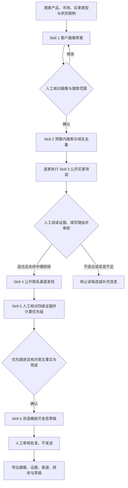

# 外贸获客：六个 Skill 的工作流

## 入口和目标

对话输入框工具栏的 **获客** 为开关，默认关闭。开启后留在对话中，当前会话后续从输入框发送的消息（含运行中排队的消息）携带六技能执行要求；关闭后新消息不再附加要求，已经开始的任务可使用停止按钮中止。开关跟随会话草稿，发送后保留，各会话独立，刷新后不保留。`/trade-buyers` 仍提供分步操作工作台。

聊天通过工作流指令协调六个技能及真实工具，需运行环境可读取技能、启用外贸插件并配置搜索服务。缺失时返回配置缺口。六技能共同参与、按依赖顺序执行，背调后等用户审核再进行联系人发现。“独立买家搜索”页签保留原第二个技能的完整预算设置和人工评测功能。能力中心 → 技能可以看到：目标客户画像、潜在买家搜索、买家背调、联系人发现、线索评分与跟进优先级、个性化开发信生成。六个技能为内置能力，旧目录在下次读取时会补入；用户原有启停设置保留。

交付物是一份可追溯的候选买家与公开联系渠道记录。没有搜索 API Key 时显示配置缺口；不会生成示例企业来填充真实结果。流程可以分步运行，不会自动联系客户或发布内容。

## 流程

### 1. 客户画像：将商家声明转为可确认的搜索起点

输入产品、目标市场、买家类型和承接限制。可点击“生成画像草案”，也可直接粘贴第一个技能的完整 JSON。当前按钮执行确定性转换：保留商家声明和时间，按产品×买家类型×市场组合查询，生成 profile_id/version、draft 状态、未核实事项；不会凭空推断认证、需求、价格或适配市场。

自由文本限制保留原文，不会自动变成硬筛选条件。高级画像分析使用技能说明中的供货事实、买家画像、rules、search_plan 及评测方法；将这些分析结果粘贴回 JSON 即可参与搜索。rules 每条需唯一 rule_id、must/exclude/should 层级；假设只能是 should。商家核对 JSON 与搜索范围，勾选确认后才开放搜索。

输出：可修改的画像 JSON。草案不是校准结果；没有人工样本时 evaluation_status=not_evaluated。修改产品或画像会清空后续结果，以免沿用旧条件。

### 2. 买家搜索：形成有来源的候选池

使用现有真实搜索供应商与公开页面读取能力。工作流每次限制4条查询、5家候选、8次网页读取、90秒；独立搜索页允许在已有范围内调整预算。先按域名标准化去重、处理排除域名及明显目录网站，再留存命中查询、来源网址、摘要、抓取状态与时间。

仅域名 equals/in 规则可自动确定，其他经营语义条件保持 unknown。搜索命中不是企业身份、真实需求或采购意向的证明。供应商失败、达到预算或连续低产出时停止，已完成结果与日志保留。没有结果时调整画像或配置后重跑。

输出：候选网站、规则三态、来源、search_log、stop_reason 和耗时。buyer_id 为标准化域名的稳定哈希，可用于跨阶段关联；不合并母子公司、集团别名或多个法人。

### 3. 买家背调：分开看匹配与证据

逐家点击“执行买家背调”。复用安全公开页面读取器读取官网/关于页面，查询 GLEIF 公开法人登记。展示每条 fact 的 source_url、evidence、状态与 sources 获取时间；同时保留画像版本、背调版本、规则结果、未知项。

官网自述、独立登记和商家填写内容分别标记。GLEIF 同名记录及登记状态不证明网站属于该法人，不是信用评级；无 LEI 记录不能判定企业有风险。自动规则只支持精确域名比较，其他语义规则待核验。整家企业默认 needs_review，硬条件失败或排除命中为 rejected；domain_rule_decision 单独列出。证据覆盖率只表示有多少事实有链接，不代表事实已独立核实。

人工阅读证据，先填写理由，再选择适合/不适合/证据不足。适合且未命中硬性排除后才开放联系人发现。重新背调后原人工审核及渠道结果失效，须重新确认；硬排除须修改画像并重新搜索。

输出：带版本的背调档案、证据、未知条件和人工审核记录。

### 4. 联系人发现：从官网取得公开渠道

审核适合后点击“发现公开联系渠道”。读取首页和同域 contact/about/team 等页面，工作流最多3页，接口最多4页，总时限45秒。只提取可见邮箱、mailto 和站内联系页；按渠道去重，可输入已有邮箱或联系页地址作为排除项。不会读取付费联系人库或自动同步 CRM。

每个渠道附 source_url、evidence、retrieved_at，状态 publicly_listed。邮箱公开列出不代表它适合营销、确属该企业或可以投递。当前实现未自动识别具名采购负责人：person_name/role=null，role_status/employment_status/deliverability=unknown。前端明确显示这个限制。找不到渠道返回 no_public_channel；不猜测姓名或邮箱。

输出：公开渠道、证据、读取日志、缺口及耗时。业务员可依此找到合适入口，随后仍需独立核对具名联系人、权限和当前任职情况。沟通、发送和 CRM 写入属于后续技能。

## 如何衡量效果

| Skill | 指标与分母 | 当前自动计算/保留 | 需要人工或后续数据 |
|---|---|---|---|
| 画像 | 筛选精确率=真正适合/被判适合；召回率=找出的合格买家/独立标注全部合格买家 | 声明、版本、查询、未评测状态 | 校准集与独立留出集；不能用模型自评当真值 |
| 搜索 | 有效率=适合/(适合+不适合)，证据不足另列；查询产出、网页读取成功率、耗时 | 候选、日志、预算、耗时；工作流人工审核后算有效率 | 搜索供应商真实账单才能算成本 |
| 背调 | 事实准确率=正确/已核实事实；证据支撑率=相关有效来源支持/抽样事实；未知规则比例、每家耗时 | 规则结果、来源覆盖计数、耗时、人工审核 | 盲审事实和来源；有合格真值集才能算漏判率 |
| 联系人 | 渠道覆盖率=有公开渠道的审核适合买家/审核适合买家；角色准确率、任职准确率 | 页面尝试/成功数、渠道数、耗时、工作流覆盖率 | 具名联系人和岗位独立核验；退信率须真实发送记录 |

页面分母为0显示“—”，不会显示0%准确率。渠道覆盖率统计本次实际完成发现的结果，未执行的审核适合买家仍计入分母，表示流程当前进度与覆盖；公开联系页也算渠道，不等于具名采购人覆盖率。审核适合与不适合以人工结论为准，未知不进入有效率分母。

首轮建议商家准备30家样本，覆盖适合、边界、不适合；先用校准集调整规则，再用留出集评估。来源可追溯目标100%，准确率/召回率的业务阈值在测试前约定。当前没有真实人工标注效果数据，不能宣称提升多少成交率。

## 数据、权限与失败恢复

- 页面可显式“保存获客进度”到当前账号的foreign_trade_acquisition_progress表；刷新后点“恢复已保存的进度”恢复最近检查点。每次修改后须再次保存；保存使用revision防止多页覆盖，409时先恢复最新进度。恢复不会重跑搜索或发送消息。另提供“导出完整获客记录”，保存 schema_version、画像及确认状态、搜索日志、背调档案、人工理由/时间/背调版本、联系渠道。当前不支持导入整份记录续跑；可粘贴导出的 profile 重新开始。
- 每个接口使用当前用户认证，数据随请求独立处理，不保留跨用户结果缓存。公开读取采用现有 DNS 公网校验、连接地址固定、重定向和响应大小限制。
- 用户确认和阶段准入由页面控制，服务器端各阶段为独立研究 API，不是持久审批引擎；单独调用联系人 API 不会核验前序人工审核。插件工具及技能说明要求保留准入依据。
- 接口前缀 `/v1/foreign-trade/buyer-search`：`/profile`、`/plan`、`/run`、`/due-diligence`、`/contacts`。页面可直接使用，不依赖安装插件；聊天原生工具 `trade_buyer_search` / `trade_buyer_research` 需要启用0.6.0外贸插件并先读取对应 Skill。
- 搜索和联系人发现失败保留已取得的部分证据；页面中可以重试当前阶段。背调失败保留页面上原有结果；重新成功后才替换并使下游审核失效。
- 没有后台定时运行、邮件发送、联系人付费数据源、完整工商信用报告或自动采购负责人核验。

## 实现位置与验证

后端：`core/foreign_trade/acquisition.py`、`buyer_search.py` 与认证路由 `api/routes/v1/foreign_trade_buyers.py`。前端：`AcquisitionWorkflow.tsx`，对话快捷按钮 `AcquisitionShortcut.tsx`。四个规范技能在 `extensions/skills/default/trade-*`，插件包携带相同副本，测试核对两份说明一致。

自动测试使用注入搜索/网页证据与模拟 API，不消耗真实搜索额度。验证认证、未知状态、硬排除、公开渠道提取、来源追踪、去重与旧目录补入；浏览器验证实际组件的确认门槛、四阶段操作、导出、下游失效和移动布局。真实供应商可用性及人工业务效果需在配置环境里进一步验收。

本次验证：前端生产构建通过（含 TypeScript、翻译、深色模式与动效检查）；两个浏览器脚本通过，覆盖工作流和独立搜索页。外贸 unittest 扫描中78项通过，另外两个既有 pytest 测试模块因容器缺少 pytest 未能加载，未计为通过。新版插件包已构建，包含9个技能、10个原生工具声明及本文档。

## 聊天获客输入与输出

输入产品及用途、目标市场、买家类型、供货能力（MOQ、价格区间、交期、认证与定制能力；不知道可写未知）。可补充产品目录、官网、历史买家、排除域名、期望数量和预算。缺少关键资料时集中追问。

示例：生产不锈钢保温杯，寻找德国和法国进口商及批发商；MOQ 500件，FOB 3–5美元，交期30天，支持贴牌，认证见附件；先找5家，排除已有客户域名清单。

输出画像及规则、带来源与匹配理由的去重候选表、逐家背调/风险/未知项/审核状态、审核通过买家的公开联系渠道、执行统计/耗时/停止原因/待补充事项。无真实结果不承诺凑足数量；公开邮箱不代表已验证采购负责人。用户回复背调审核后继续后续阶段。

## 第五与第六个技能（已实现）

第五个技能使用认证 API `/v1/foreign-trade/buyer-search/prioritize`，复用同一买家的背调版本和人工审核记录。前端提供四维证据表单，非未知判断必须填写摘录、公开URL和获取时间。权重35/25/20/20，partial计一半；未知从匹配分分母中排除，同时降低覆盖率和排序分。拒绝联系、硬排除或不适合进入停止队列。覆盖不足75%或未审核适合先补资料；匹配不足75分暂缓；无渠道先补资料；其余优先跟进。门槛为未经业务校准的v1，页面明确标注；当前不自动进行语义证据核验。

第六个技能使用认证 API `/v1/foreign-trade/buyer-search/outreach`，重新计算传入的完整线索评分，只有follow_up且用户确认资料可生成。输入英文发件公司、产品、供货声明、声明来源、已发现渠道及沟通目标；可选英文买家事实须关联符合或部分符合的同维证据。当前使用确定性模板，不调用额外模型；输出两个主题行、英文正文、中文审核对照、证据及输入快照。中文对照保留英文产品、买家事实与供货声明原文，未自动翻译。用户自行核对语义，程序未独立核验真实性。使用团队称呼，不推断采购负责人。

前端新增跟进队列、逐家评分、开发信生成、主题选择及草稿批准。评分变更、商家资料编辑、渠道修改、重新背调和审核变化使相关旧草稿/批准失效。导出schema 1.1含leads，每个score/draft包含输入快照、规则版本/生成方式；approved_at与review_started_at供审核耗时分析。状态仅在当前页面，离开需导出。后端为无共享状态的计算接口，不保存审核账本，不独立验证传入的前序记录，不发送邮件或写CRM。

验收指标：独立人工标注的前20条合格率、召回率、排序一致率与引用正确率；草稿可用率、含无依据断言草稿比例、人工审核耗时。当前未进行业务样本校准，不展示虚构成功率；回复率/商机率需真实投递和商机数据后才可计算。

第七/第八技能另以对话「客户跟进」开关组合第四、第五技能；原六技能获客入口保留。契约、分流和效果评估见 [客户跟进工作流](FOLLOWUP_WORKFLOW.md)。
