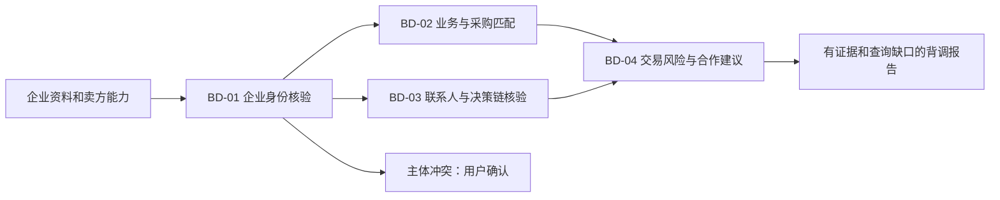

# 客户背调四技能工作流

对话框「客户背调」开关替换「客户跟进」，与获客互斥。立即发送、排队消息均捕获开关状态；不同会话与账号隔离，斜杠命令及显式调用不注入工作流。原跟进技能保留在能力中心，但不再作为对话框快捷入口。

## 输入与输出

至少提供企业名称，并补充官网、注册国家或登记号以区分同名企业。业务匹配需要卖方产品及供货约束，联系人阶段可提供已有联系人和公开来源。交易评估补充金额及币种、付款条件、合同/收款主体和账户变更情况。缺少资料时可完成不依赖该资料的部分，不补猜测。

模型读取四技能后按依赖调用 trade_buyer_research 的 identity-check、business-fit、decision-chain、transaction-risk。HTTP入口为经过登录认证的 POST /v1/foreign-trade/buyer-search/diligence/{stage}。聊天另有插件可用性与逐技能读取检查。总报告由对话模型根据四份实际回执编排，后端不建立自动后台执行器。

## 实际能力与边界

- 身份和业务阶段复用现有受限公开网页及GLEIF读取。GLEIF覆盖有限，网页可访问或登记同名不证明主体绑定。自动品类词提取范围有限；完整业务画像由对话模型依据真实公开资料组织，不宣称后端已有完整语义分类器。
- 联系人阶段复用公开邮箱和联系页提取；具名人员任职、采购权限与决策链依赖补充来源和人工核验。现有第四技能负责发现，本技能核验并保留未知。
- 风险阶段确定性检查合同/收款主体名称差异及用户报告的账户变更；它们触发核实，不直接证明欺诈。信用、司法、制裁没有新增商业数据库连接，默认未查询；输入相应来源也只是待审核证据，不表示实时数据库已完成查询。
- evidence要求唯一ID、公开来源URL、带时区获取时间、来源类型和原文；findings须引用实际原文子串。原文关联不证明资料真实、结论语义正确或主体归属，审核状态始终保留。无公开URL的用户附件在报告中标识来源，不伪造URL。
- 用户明确确认主体后可传identity_reviewed及审核说明，仅代表用户声明。重大冲突先确认；负面记录保持候选，不把同名记录自动归属。
- 请求结果含company_id、report_version、input_snapshot、rule_version及四阶段状态；不自动保存报告、同步CRM、发消息或授信。需要留存可在对话中要求导出。

## 评测

每项SKILL.md定义指标公式。核心为主体匹配准确率和错合并率、业务事实及采购信号准确率、任职和采购角色准确率、高风险漏检和误报率。原文关联率只证明结构校验，不能代替业务准确率。

使用业务员标注的脱敏样本，覆盖同名企业、品牌/法人差异、离职、过期资料、冲突来源和同名司法记录。指标需报告样本、分母、标注口径；没有实测数据时返回不可计算。人工背调耗时采用中位数与同条件基线比较，不承诺回复率或成交提升。

## 验证

后端覆盖证据伪造/未来时间/重复ID、身份冲突、缺项、负面候选、来源类型覆盖、收款主体差异、账户变更、API认证和聊天技能权限、技能镜像及目录加载。前端覆盖四技能注入、开关互斥、队列快照、命令旁路、会话与账号隔离，并执行真实浏览器组件回归与生产构建。
