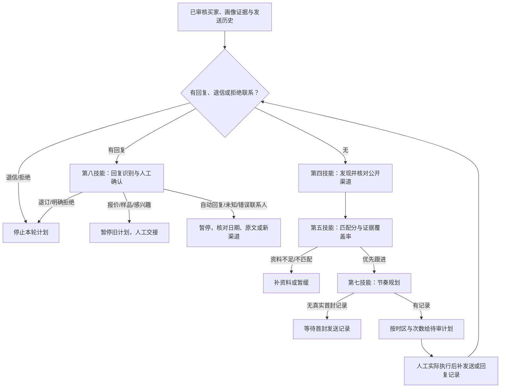

# 客户跟进工作流：第四、第五、第七、第八技能

对话输入框新增「客户跟进」开关，与原「获客」开关互斥，按会话保存，切换账号清空。开启后下一条普通消息、排队消息均携带四技能工作流指令；斜杠命令及显式直接消息保持原语义。不是应用跳转，不依赖应用ID。模型须能读取已启用外贸插件的技能并调用真实工具；未配置模型或搜索时报告缺口。

## 新技能实现

| 技能 | 执行入口 | 核心输出 |
| --- | --- | --- |
| 7 跟进节奏规划 | trade_buyer_research(action=cadence) 或认证POST /v1/foreign-trade/buyer-search/cadence | 计划状态、停止理由、评分、带时区跟进时间、目的、输入快照和规则版本 |
| 8 客户回复识别与分流 | trade_buyer_research(action=reply-triage) 或认证POST /v1/foreign-trade/buyer-search/reply-triage | 原文匹配证据、候选意图、人工确认状态、暂停/拒绝联系标记、下一步及缺失条件 |

两技能均已加入内置能力中心与外贸插件。聊天工具校验当前账号插件可用性和技能读取状态；HTTP接口沿用现有获客接口的登录认证边界，不独立要求插件加载。计算接口无共享状态、不独立验证传入审核和发送记录的真实性。

### 用户传入什么

沿用当前对话资料：买家ID/官网/名称、背调版本、人工适合审核及理由、产品/买家类型/市场/供货四维匹配证据、排除条件、拒绝联系状态。联系渠道沿用第四技能真实输出，保留公开来源和获取时间，核对联系用途。

新增输入：买家IANA时区（如Europe/Berlin）、首次及后续实际发送时间、最多跟进次数（0–3）、退信状态。有回复则提供完整原文、邮件编号等来源和带时区接收时间。未发送、未审核、未知时区不能靠默认事实填充；缺项集中询问。

### 输出什么

逐买家交付公开渠道与未核实项、匹配分和覆盖率、计划时间/目的/状态、回复意图候选及原文证据、待人工确认项、询盘/样品等下一步交接。保留规则版本、生成时间和输入快照。

第七技能默认3/7/14日，买家当地09:30，周末顺延；后续与前一步或最近实际发送至少约3日。输入带时区日期，用IANA时区处理夏令时。逾期步骤标记overdue_review，不能立即补发。无真实首封记录返回awaiting_initial_send；达到上限exhausted；渠道用途未确认needs_channel_review；不满足第五技能门槛blocked_priority。

第八技能使用中英文关键词规则给候选，不宣称是AI语义分类。未经人工确认intent保持unknown；confirmed_intent须附原文逐字证据。退订线索优先阻止营销；即使误命中引用链也先暂停，再人工核对。分类含opt_out/not_interested/wrong_contact/out_of_office/request_quote/request_sample/interested/unknown。多意图、否定和其他语言需人工复核。任何回复暂停旧节奏。

本轮不发送、不同步CRM、不自动读取邮箱、不创建后台任务；没有跨会话拒绝名单或审核账本。刷新会话后应提供完整历史，不能把输入快照当可信数据库。报价或样品分流只列待补条件，实际保存询盘需用户明确要求后使用已有询盘工具和最新revision。

## 指标和验收

| 技能 | 指标与计算方式 | 解释 |
| --- | --- | --- |
| 7 | 停止规则违规数、重复步骤数、时间/时区错误数 | 回放完整真实历史，目标均为0；单测通过不等于实际运营已零违规 |
| 7 | 人工审核耗时中位数 | 开始审核到结束，附样本数；当前接口不自动采集 |
| 7 | 正向回复率=正向回复买家数/实际送达买家数；退订率=退订买家数/实际送达买家数 | 按买家公司去重、统一周期、随机对照；计划不等于送达 |
| 7 | 单个正向回复成本=实际支出/正向回复买家数 | 无实际成本或分母为0时不计算 |
| 8 | 每类precision/recall、macro-F1、混淆矩阵 | 以独立人工标注测试集评测，按公司拆分，规则候选与人审结果分开统计 |
| 8 | 退订漏检率=未停止真实退订数/真实退订数 | 目标0；当前未经业务数据评估 |
| 8 | 人工修正率、未知比例、审核耗时中位数、交接完整率 | 同时反映误判和人工负担；零未知不能作为单独优化目标 |

初始阈值、节奏及关键词均为v1未校准版本，无真实投递/标注数据时明确标为未评估，不能承诺回复或成交提升。

## 验证范围

自动测试覆盖停止与暂停、退订优先、原文证据、未知和多意图、时间顺序/买家身份约束、时区/夏令时/周末、次数与逾期、API认证、聊天技能权限、能力中心收录、镜像一致性、开关互斥、会话/账号隔离和排队消息快照。浏览器测试使用模拟后端，不证明实时搜索或外部消息送达。
