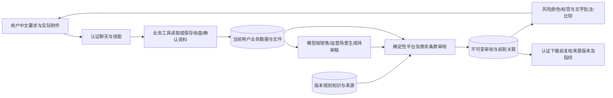

# 赛题演示与可重复验收脚本

本文对应 2026-10-31 的公开实现，是**待执行的验收脚本和预期结果**，不是“全部已通过”的实测记录。执行者必须另行保存本轮真实工具回执、页面状态、下载检查及失败信息；不能把下方预期回答复制成助手已经完成的证据。结构化用例见 [hackathon_scenarios.json](../tests/fixtures/hackathon_scenarios.json)。

主入口是聊天中启用的“外贸业务助手（演示）”，工作台用于核对、修正和下载。工作流 A 面向销售处理 Alibaba RFQ；工作流 B 面向运营准备 Amazon Listing。两者都由中文要求驱动英语产出，并各完成“首轮审核 → 用户修正 → 第二轮审核”。本项目选择赛题允许的**两类角色/场景**路线，不把英语/西语校验能力说成两种语言均已现场实测。

## 赛前准备

按 [TEAM_SETUP.md](TEAM_SETUP.md) 完成新实例的 `clone main → setup → init → start → check`，或对正确的既有 app-home 执行更新。账号、模型密钥、数据库和上传文件留在本机，不随 Git/插件 ZIP 同步。只有新实例使用默认 `~/.foreign-trade-agent`；已有实例必须沿用原目录，不能为解决问题重新 init 空库。

队友网页默认 <http://127.0.0.1:3001>；本机演示选择 <http://127.0.0.1:3002> 避开其他服务。端口约定不代表服务已启动或验收通过。3001 已属于其他容器/服务时保留对方，确认本公开实例已停止后，用同一原数据目录执行：

```bash
TRADE_APP_HOME="/absolute/path/to/your/existing-app-home"
test -f "$TRADE_APP_HOME/data.db" && \
  .venv/bin/python extensions/foreign_trade/team.py start --app-home "$TRADE_APP_HOME" --port 3002
# 另一个终端设置同一 TRADE_APP_HOME 后：
.venv/bin/python extensions/foreign_trade/team.py check --app-home "$TRADE_APP_HOME" --port 3002 --running
```

这时打开 <http://127.0.0.1:3002>；不要同时在两个端口启动同一数据目录。setup/build 之后还需 init/install 才有一致的外贸首页、提示词和插件。首次旧库迁移按部署指南，不能省略迁移顺序或用 `stamp` 绕过约束。

在系统设置配置自己的工具调用模型、服务地址及实际支持的上下文长度，并分配给 `main_agent`。对适用且未显式指定协议的兼容模型，保存时会自动探测协议和工具结果往返，探测不明确不算成功。维护者的网关连通性配置示例为 `gpt-6.1-sol`、`Responses`、`context_length=128000`；128000 是保守工作窗口，不是该第三方线路的最大容量证明，更不能据模型名套到其他服务。页面上下文窗口必填，无法自动探测时须手工确认；无需把密钥或模型服务地址写入本演示脚本。

连接测试正常不等于真实工具编排已通过；先做一次产品查询，看到真实工具结果后再开始。新聊天输入 `/` 选择 0.4.0 外贸插件，检查五技能及八个会话绑定业务工具，其中包括 `localization-review` / `trade_review`；另有三个目录/报价 MCP 工具，不混为“八个 MCP”。完整清单见 [部署指南](TEAM_SETUP.md#3-创建自己的实例和安装插件)。只打印工具 JSON 不算调用。

工作台操作和无模型备选详见 [DEMO_WALKTHROUGH.md](DEMO_WALKTHROUGH.md)。该文档中的旧日期验收状态是历史记录，本脚本不据此推定当前模型成功或失败。快速离线 `check`、单元测试、健康检查都不能替代本脚本的真实模型与文件核验。模型不可用时可继续显式本地原文模板流程，但不能把它计作聊天编排或 AI 翻译通过。模板生成本身不调用模型，通过聊天发起模板仍需要聊天模型；完全无模型时从工作台操作。买家公开核验仍需互联网，已有版本知识的确定性审核不需现场抓取政策页。

## 六项基础要求与验收落点

| 赛题要求（保留原意） | 公开实现与配置 | 触发、角色与产出 | 必须查看的证据和异常 |
|---|---|---|---|
| 1. 中文/目标语言输入；至少两种语言或两类角色/场景本地化产出；至少两轮对话迭代 | [本地化技能](../extensions/foreign_trade/plugin/skills/localization-review/SKILL.md)、[审核工具](../src/backend/core/llm/tools/foreign_trade_review_tool.py)；`foreign_trade_reviews` 保存不可变稿件与比较 | A 销售 RFQ、B 运营 Listing；中文指令 → 英语目标稿；A3/A4、B3/B4 分别两轮 | 两个不同 review_id，第二轮关联实际 previous_review_id；只有解释文字没有回执算未完成 |
| 2. 至少两个目标平台/场景的本地化业务适配，非直译 | `channel=alibaba_rfq/amazon_listing`；来源、角色、字段由技能与 review 服务约束 | RFQ 回应 SKU、数量、包装、目的地和报价范围；Listing 分标题、Item Highlights、bullets，以消费者可理解的规格为主 | 对比格式、语气、业务目的；不可将 DESK 批发报价混入 Pi 零售页面；错站点不得套用 US 基线 |
| 3. 至少两类校验和两种反馈方式 | [版本化规则](../extensions/foreign_trade/knowledge_rules.json)、[ReviewService](../src/backend/core/foreign_trade/review.py)、[TradeReviewCard](../src/frontend/src/components/chat/TradeReviewCard.tsx) | 平台规则 + 报价商务条款；稿件彩色风险标记 + 逐条文字批注（片段/原因/建议/来源），附前后比较 | `checks/risk_labels/text_annotations/comparison` 与卡片一致；范围/付款/有效期/Incoterm 未决仍显示，不称法律认证或全面合规 |
| 4. 创建应用/智能体，配置角色、任务、交互及工作流/场景/知识，完成实际调用 | [安装配置](../extensions/foreign_trade/install.py)、[插件声明](../extensions/foreign_trade/plugin/plugin.json)、各技能、`foreign_trade_knowledge_rules` | 当前用户启用外贸助手，明确销售/运营任务，聊天工具串联工作台和规则知识 | 运行中的安装状态、技能读取、至少一次实际工具回执；此项不能仅凭源码或 ZIP 判为完成 |
| 5. 现场可重复“理解→生成→校验→反馈”，至少两个相关工作流 | A1–A4 与 B1–B4；[结构化用例](../tests/fixtures/hackathon_scenarios.json) | 明确输入 → 读真实来源 → 生成/接收待审稿 → 规则审核 → 用户修正 → 再审核/下载 | 完整执行两条链，记录实际时间、结果和中断；遇到模型失败如实停止该聊天步骤 |
| 6. 解释输入、业务数据、模型结果、校验结果的传递/调用/返回/异常 | 下文调用链、SQL 落点、接口及异常表 | 输入和附件归当前用户；业务工具返回事实，模型生成待审稿，规则服务输出确定性反馈，前端渲染/认证下载 | ID/revision 来自真实回执；401/403/404/409/422/模型失败各有处理；不输出密钥、不跨账号读取 |

多岗位协同 C 是补充，不是依赖独立账号的多人权限系统，也不代表启动了多个自主 agent。两个主流程由一个当前用户会话编排业务工具即可；不要以角色标签数量夸大架构。

## 数据、SQL 与调用关系

以下表名来自公开 ORM 模型；它们是结构说明，不是本轮数据库已产生记录的证明。

| 数据与来源 | SQL / 文件落点 | 负责代码与边界 |
|---|---|---|
| LYRECO 官网自述、GLEIF 名称/注册国匹配、团队询盘原文 | `foreign_trade_inquiries`：`inquiry_id, owner_user_id, revision, payload`；买家卡/报价/草稿/跟进在 payload 中，**无独立报价表** | [inquiry.py](../src/backend/core/foreign_trade/inquiry.py)、[public_data.py](../src/backend/core/foreign_trade/public_data.py)、[模型](../src/backend/core/db/models/foreign_trade.py)；公开登记不证明来信人、信用或交易关系 |
| DESK 商品、MOQ、阶梯价、包装条件 | [catalog.json](../extensions/foreign_trade/catalog.json)，计算快照随询盘保存 | [engine.py](../extensions/foreign_trade/engine.py)、[mcp_server.py](../extensions/foreign_trade/mcp_server.py)；模拟金额由程序计算，模型不补算价格 |
| Pi 公开规格、上传 CSV/原图、确认事实和输出 | `artifacts` 的 `artifact_id/user_id/storage_key` 与本机存储；`foreign_trade_content_packs` 的 `pack_id/owner_user_id/revision/payload` | [Artifact](../src/backend/core/db/models/artifact.py)、[内容模型](../src/backend/core/db/models/foreign_trade_content.py)、[content.py](../src/backend/core/foreign_trade/content.py)、[content_generation.py](../src/backend/core/foreign_trade/content_generation.py)；来源与图片许可分别保留 |
| 平台及项目商务规则 | `foreign_trade_knowledge_rules`：`rule_key, knowledge_version, rule_id, rule_version, category, status, payload` | [规则模型](../src/backend/core/db/models/foreign_trade_review.py)、`KnowledgeService`；检索/审核使用时按版本持久化，旧版本不被悄悄覆盖；当前包 2026-10-31.1 |
| 两轮本地化草稿及批注 | `foreign_trade_reviews`：`review_id, owner_user_id, source_type, source_id, channel, previous_review_id, payload` | [审核模型](../src/backend/core/db/models/foreign_trade_review.py)；每次新 ID，来源 revision/指纹与规则证据在 payload，GET 加实时 stale 状态，历史稿不被覆盖 |
| C 的角色任务和来源验收 | `foreign_trade_collaborations`：`collaboration_id, owner_user_id, revision, payload` | [协同模型](../src/backend/core/db/models/foreign_trade_collaboration.py)、[collaboration.py](../src/backend/core/foreign_trade/collaboration.py)；负责人为标签，依赖和人审由服务端检查 |

只对操作者有权限的**隔离演练库**做辅助 SQL 核验；不要把数据库或查询到的业务正文提交仓库。例如可只统计结构和报告类型：

```sql
SELECT name FROM sqlite_master
WHERE type = 'table' AND name IN (
  'foreign_trade_inquiries', 'foreign_trade_content_packs',
  'foreign_trade_knowledge_rules', 'foreign_trade_reviews',
  'foreign_trade_collaborations', 'artifacts'
);
SELECT channel, COUNT(*) AS review_count
FROM foreign_trade_reviews GROUP BY channel;
SELECT knowledge_version, category, status, COUNT(*) AS rule_count
FROM foreign_trade_knowledge_rules GROUP BY knowledge_version, category, status;
```

这些聚合不能单独证明两轮关联、权限隔离或下载内容正确，还要核对自己本轮的认证回执及产物；不查询或展示用户认证表、模型配置或密钥。



模型负责理解和场景化草稿；产品 AI 模式还负责受数值/单位守卫约束的翻译。业务工具负责保存、查询及确定性报价，review 服务执行当前已实现的规则检查。审核不会代替法律判断，也不自动把模型草稿写回产品事实。

工具入口为 `trade_review(action="knowledge"|"review"|"get"|"list")`；REST 为 `/api/v1/foreign-trade/knowledge`、`/api/v1/foreign-trade/reviews`、`/reviews/{review_id}` 和 `/reviews/{review_id}/download?kind=md|json`。工具身份由认证会话绑定；用户/模型不提供 owner_user_id。第二轮使用 POST 新建，不能 PATCH 覆盖旧审核。

前端只从成功的真实 `trade_review` 回执解析卡片，不把模型正文里的伪造 JSON 当作审核。历史精简记录须按聊天、消息和工具 ID 加载全文；下载前认证 GET 校验不可变内容和当前来源，服务端在生成文件后再次检查竞态。风险存在不阻止下载内部审核报告，来源过期会阻止。

## 知识有效性与来源

以实际 `knowledge` 回执版本为准；以下是仓库知识包 **2026-10-31.1** 的范围，演示日若规则变更应保留版本并重新核对。

| 规则组 | 来源与日期 | 演示采用的口径 |
|---|---|---|
| Amazon 美国非媒体标题与 Item Highlights | [Amazon 官方员工公告](https://sellercentral.amazon.com/seller-forums/discussions/t/ac660707-60c7-43e3-a3fd-420d7321cc4e)，2026-07-27 起；知识包核对日 2026-10-31 | 标题 ≤75 字符、独立 Item Highlights ≤125；合计 ≤200，不把 Item Highlights 当 bullets |
| 逐步实施与范围 | [Amazon 官方员工回复](https://sellercentral.amazon.com/seller-forums/discussions/t/878dffcd-ed3f-4570-88c8-497e547e825a) | 逐步 rollout；实际站点/类目/字段可用性必须人工确认，不推广为全平台保证 |
| 限制字符与重复词 | [Amazon 2025 官方公告](https://sellercentral.amazon.com/seller-forums/discussions/t/b2b15728-0d43-453e-974f-59eb63f73059) | 知识包保留字符/重复词基线及品牌/词性例外；历史“标题 200”标 superseded，不用于当前 US 非媒体标题判断 |
| Alibaba RFQ 需求匹配 | [Alibaba RFQ 官方指引](https://seller.alibaba.com/rfq)，知识包核对日 2026-10-31 | 回应规格、数量与时间；这是平台实践指引，不擅自改称强制法律条款 |
| 金额、运税、付款、有效期、Incoterm、认证依据、模拟声明 | [项目规则实现](../src/backend/core/foreign_trade/review.py) | 项目确定性商务一致性与待确认规则，明确标为项目来源；不伪装成 Amazon/Alibaba 官方政策或法律意见 |

本次编写时重新打开了上表 Amazon 2026 公告/逐步实施回复和 Alibaba 指引；没有取得的帮助中心正文不写成已经归档。外部页面只用其公开可读信息，不爬取需授权内容；后续执行保留失败状态与实际获取时间。知识检索使用版本化本地包，不需要现场批量抓取政策网站。

## 工作流 A：LYRECO 公开资料 → 模拟询盘报价 → Alibaba RFQ 两轮审核

每次演练新建自己的记录。LYRECO 是真实公开公司，DESK-001 的商品、询盘、价格和交易是团队模拟。不得编造采购联系人或暗示已与 LYRECO 合作。

A2 中先把 `${FOLLOWUP_DUE_AT}` 替换为未来的带 `+08:00` 偏移 ISO 时间；保留 `Asia/Shanghai`。不要原样发送占位符。下列“预期助手输出要点”用于核验，不是要求助手照背。
### A1 · 用户输入

```text
请完整读取买家核验与询盘跟进技能，创建“赛题演练 A · LYRECO DESK-001”询盘。LYRECO、注册国 FR、官网 https://www.lyreco.com/group/，邮箱留空。这是团队构造的演示询盘，不是真实邮件、订单或合作关系。
询盘原文：TEAM-CREATED DEMONSTRATION ONLY. This is not an actual LYRECO inquiry, order or business relationship. Please quote 1000 units of DESK-001 Modular Desk Organizer with custom packaging for delivery to Spain. Production days are not specified. Freight, taxes, duties, shipping time and other commercial terms require separate confirmation.
请保存明确条件，核验公开资料，查询产品规格、MOQ及模拟阶梯价，计算报价并保存未发送的中英文回复草稿。不要联系客户。金额以本轮工具回执为准，不把公司注册国当目的国。
```

预期助手输出要点：

- 发生真实保存、公开核验、产品检索、报价及草稿工具调用；给出本次实际询盘ID与当前revision，不能用正文JSON代替执行。
- 公开官网自述与登记匹配分别带来源/获取时间；无结果或网络失败标为未核实，不推断信用或来信身份。
- 单项DESK-001、1000件、定制包装、Spain；USD4800货值+300包装=5100，不含运费税费；参考生产18天不等于到货时间。
- 显示询盘状态卡、模拟标记、中英PDF/Excel报价卡和未发送草稿；无库存、免费运费、认证或实际订单承诺。

操作者核验：

- 打开本轮PDF/Excel检查金额、包装、费用范围、来源及DEMO标记；Excel有中文/英文两个工作表。

### A2 · 用户输入

```text
为刚才这条演示询盘添加站内跟进待办：“核对包装图稿和运费，未实际联系客户”。到期时间为 ${FOLLOWUP_DUE_AT}，时区 Asia/Shanghai。请先核对这是未来时间，保存后回显实际时间和待办状态；不要说已发邮件或保证推送。
```

预期助手输出要点：

- 时间参数由操作者填入明确的未来ISO8601时间，保留时区；调用add_followup并返回真实待办状态。
- 如时间缺失或已过期，澄清后再保存；站内待办不是自动通知承诺。

### A3 · 用户输入

```text
现在以销售岗位准备 Alibaba RFQ 英语回复。请完整读取本地化审核技能，重新读取本询盘及当前报价，再检索 channel=alibaba_rfq 的平台规则和报价商务条款知识，报告规则版本与来源。
下面是我刻意提供的错误测试稿，只供内部审核，请保持原样送审，不可发送，也不要先悄悄纠正：
Title: DEMO RFQ reply
Body: DEMO DESK-001 500 units. Total USD 6000.00. Free shipping, taxes included. Production within 2 days. CE certified.
Item Highlights: 留空
Bullets: 空数组
Language: en
Locale: en_US
请实际调用审核工具，展示原稿风险颜色/标签及逐条文字批注，说明原片段、原因、修改建议和来源。不要把检索到规则说成已经通过平台认证。
```

预期助手输出要点：

- 使用trade_review knowledge，随后review；source_type=inquiry、source_revision来自最新get，不用模型猜ID/修订号。
- 首轮有实际review_id、checks、risk_labels、text_annotations；数量/金额/费用/生产时间矛盾被指出，认证缺依据保留待确认。
- 两反馈同时可见：稿件颜色风险标记，以及带片段/原因/建议/来源的文字批注。
- 明确此稿是测试负例、未发送未发布；风险报告本身可下载，不代表可对外使用。

### A4 · 用户输入

```text
请按刚才批注修正为适合 Alibaba RFQ 的简洁礼貌销售英语，必须保持以下事实正文，不新增承诺：
DEMO DESK-001 1000 units with custom packaging for Spain. Goods total USD 4800.00; packaging total USD 300.00; subtotal USD 5100.00. Freight and taxes excluded. Reference production lead time: 18 days, subject to supplier confirmation; shipping time is separate. Payment terms, quotation validity and Incoterm remain pending confirmation. Please confirm the delivery address and packaging artwork. Demo quotation — simulated data, not a binding commercial offer.
请重新读取来源并实际复审，previous_review_id 使用上一轮真实审核ID，保留旧报告。展示修正前后需修改/待确认数量，以及已解决、仍存在和新增反馈；如果来源或规则改变请单独说明。不要为清零删除真实未知项。
```

预期助手输出要点：

- 新建第二个不可变review_id，并关联首轮previous_review_id；不是覆盖首轮或口头宣称修复。
- 在本fixture来源和规则不变时，数量/金额/免费运税/过短生产承诺等问题消除；付款、有效期和Incoterm仍待确认。
- 展示comparison及source_changed/rules_changed；未知商务条件不写成已批准或全合规。
- 下载审核Markdown/JSON前重新核验当前来源和用户权限，两个报告ID与各自草稿相符。

操作者核验：

- 点击本次审核卡MD/JSON并查看正文、批注、rule_version、previous_review_id和comparison；保留本次真实下载证据。

## 工作流 B：Pi 实际附件 → 确认事实/英文资料 → Amazon Listing 两轮审核

先准备 [双语事实 CSV](../extensions/foreign_trade/demo_product/product_facts.csv)、[许可原图](../extensions/foreign_trade/demo_product/raspberry-pi-5-original.jpg) 和 [图片许可](../extensions/foreign_trade/demo_product/PHOTO_LICENSE.txt)。这是来自 Raspberry Pi 官网的 8 条规格，不是供货或经销证明。B1 必须实际上传到聊天，不把磁盘路径粘贴当作上传成功。 即使当前模型不支持看图，应用也会提供经归属校验的图片文件引用，让业务工具导入原图；用户无需手填内部文件编号。这不代表模型已识别图片内容。

现场无模型备选使用 [英文事实 CSV](../extensions/foreign_trade/demo_product/product_facts_en.csv) 和工作台的“本地原文模板（不调用模型）”。模板不翻译，不要求模型；但它不证明本节 AI 路线或聊天已通过。无论哪种模式，三图都只是基于许可原图的缩放、排版和文字叠加，**不是 AI 生成产品图**。确认之后才可生成，英文失败时不能谎报三图完整。
### B1 · 用户输入

先实际附上：

- [product_facts.csv](../extensions/foreign_trade/demo_product/product_facts.csv)
- [raspberry-pi-5-original.jpg](../extensions/foreign_trade/demo_product/raspberry-pi-5-original.jpg)

```text
我已把产品事实CSV和许可原图实际附到当前聊天。请完整读取产品内容技能，导入新的“赛题演练 B · Raspberry Pi 5”资料包。产品名称/型号 Raspberry Pi 5，品牌 Raspberry Pi，主要来源 https://www.raspberrypi.com/products/raspberry-pi-5/。
图片署名：Photo: SimonWaldherr, Raspberry Pi 5.jpg (CC BY 4.0). Layout and text added; original photo retained. Source: https://commons.wikimedia.org/wiki/File:Raspberry_Pi_5.jpg License: https://creativecommons.org/licenses/by/4.0/
先展示8条候选事实、来源、图片署名和未知商业条件，等待我核对。不要从图片推断RAM、售价、库存、认证或经销授权；Pi不得使用DESK模拟价格。
```

预期助手输出要点：

- trade_import_product使用当前聊天实际file_ids，不能读磁盘路径或猜文件ID；成功导入后给出真实pack_id/revision。
- 展示8条候选事实，保留数字/单位/来源，尚未确认/尚未生成；等待下一条人工确认。
- 原图是许可公开照片，排版保留作者/来源/CC BY4.0及修改声明。

### B2 · 操作者实际核对后再发送

```text
我已逐项对照当前显示的8条候选事实和来源，并核对本次图片使用许可与完整署名，确认采用全部8条。请先确认事实，再以AI翻译与生成模式制作英文商品介绍、FAQ及三张基于原图的排版图。保留全部数字、单位和未知商务条件，不补造RAM容量，不把图片排版说成AI生图。请按实际回执说明翻译是否成功；没有生成的文件不要声称存在。
```

预期助手输出要点：

- 仅在操作者实际核对后发送本轮；trade_confirm_product_facts成功后用返回的新revision单独generate。
- AI成功标识为method=ai_grounded；generation_mode=ai但method=template代表回退，不能计作AI翻译通过。
- 成功且事实均英文时，8条事实对应11条FAQ、三种规定尺寸图片及ZIP；实际数量以回执为准。
- 中文未成功翻译时英文图片暂停；原事实和原图保留，提示失败/回退，不擅自改为成功。

操作者核验：

- 打开文案、FAQ、三张PNG及ZIP；核对来源、8条事实、数值/单位、图片署名及未发布状态。

### B2b · 可选：按来源修订翻译术语

只在首轮译文确有术语问题时执行，准确译文不需要制造错误。数字守卫不等于术语已完全准确：例如中文“60帧”与英语“60-frame”都保留60，但没有明确每秒速率。应对照同一份双语CSV的英文列，而不是把任何“帧”一律改成fps。

```text
我已对照上传双语CSV同一官方来源的英文列，确认显示输出应表述为“Two HDMI outputs supporting 4K at 60fps and HDR”。请读取当前资料包，只将第3条显示输出事实的value更正为这句话，保留其来源、其余7条事实、原图与署名，不补新规格。我明确确认本次更正；保存后以新revision重新AI生成英文资料，并比较前后该术语。旧文件保留历史说明，只提供当前新版本下载。
```

预期助手输出要点：

- 使用当前ID/revision只修改指定事实，旧输出失效；不以下载文件手工改字冒充已落库。
- 明确依据已有双语资料的英文列补充fps单位，不把任意“帧”都猜成帧率。
- 在重新确认后的新revision生成并实际检查60fps、数字/单位、FAQ、三图和ZIP；旧revision下载应拒绝，新版可回读。
- AI失败仍如实显示回退；这条可选操作是人工修订流程，不宣称通用翻译缺口已由源码修复。

工作台等价操作：打开当前资料包 → 只编辑对应事实的值 → 保存资料 → 对照来源重新勾选确认 → 选择AI翻译与生成 → 检查新版输出和下载。旧下载仍为历史快照。这是可执行修订流程，不表示通用术语校验已经覆盖所有中文单位。

### B3 · 用户输入

```text
现在改为运营岗位，为美国非媒体类目准备 Amazon Listing 英语文案。请完整读取本地化审核技能，读取刚才已确认并生成的Pi资料包，检索 channel=amazon_listing 的当前平台与报价条款知识，使用 en_US。
下面是刻意构造的错误测试稿，只供内部检验，保持字段原样送审，不可发布：
Title: Raspberry Pi 5! Raspberry Pi 5 Raspberry Pi 5 Single Board Computer for Home Office Education and Everyday Projects
Item Highlights: Broadcom BCM2712; 2.4GHz; quad-core 64-bit Arm Cortex-A76; two HDMI outputs supporting 4K at 60fps and HDR; two USB 3.0 and two USB 2.0 ports; Gigabit Ethernet
Body: Free shipping. Official authorized distributor. CE certified.
Bullets: Two USB 3.0 and two USB 2.0 ports; Gigabit Ethernet
请实际审核，分开显示Title和Item Highlights字符数与批注，解释2026规则的市场/类目/逐步实施范围，同时保留商务未知项；不要沿用历史200字符标题上限。
```

预期助手输出要点：

- 新建source_type=content_pack的真实review；role=operations/channel=amazon_listing，与RFQ销售语气和结构不同。
- Title超过75、Item Highlights超过125、合计超过200，以及标题字符/重复词产生反馈；数字是当前知识版本的US非媒体基线。
- 免费运费与无依据授权/认证被指出；本项目商务规则与Amazon官方来源明确区分。
- 显示稿件风险标记和逐条批注；Amazon范围/实际rollout始终待人工确认，不宣称平台批准。

### B4 · 用户输入

```text
请按批注修订这份 Amazon US 非媒体英语Listing，保留如下短字段并以客观规格面向消费者解释，不写B2B询盘报价：
Title: Raspberry Pi 5 Single Board Computer
Item Highlights: 2.4GHz quad-core Arm Cortex-A76; dual 4K60 HDMI; Gigabit Ethernet; USB 3.0
Body: Product information based on the confirmed Raspberry Pi 5 facts. Confirm the exact variant, included accessories and commercial terms before purchase.
Bullets: Two USB 3.0 and two USB 2.0 ports; Dual-band 802.11ac Wi-Fi; Bluetooth 5.0 with BLE; 5V/5A DC via USB-C with Power Delivery support
请去掉无依据的免费运费、认证和经销授权承诺，保留范围及商务条件待确认。重新读取来源，实际复审并传上一轮真实previous_review_id，展示两轮风险变化，提供本次Markdown/JSON审核报告入口。不要上架。
```

预期助手输出要点：

- 生成新审核ID、保持旧稿不可变，previous_review_id和来源关联正确。
- 固定测试稿的标题/Item Highlights/合计均在基线内，不再出现超限、限制字符或三次重复词反馈；不是保证所有平台规则通过。
- 保留US非媒体范围/rollout及付款、有效期、Incoterm待确认，显示comparison的已解决/持续/新增规则。
- MD/JSON包含此次草稿、证据、批注、比较及未发送未发布状态。

操作者核验：

- 对比两轮卡片和下载报告；不要把旧产品ZIP中的基础文案当成已同步更新的Amazon审核稿，两者是独立产物。

产品资料成功输出的目标文件：`english-listing.md`、`customer-faq.csv`、`product-square.png`（1200×1200）、`product-landscape.png`（1600×900）、`product-spec.png`（1200×1600）以及 ZIP。8 条事实对应 11 条 FAQ；ZIP 目标为上述五文件加 `facts.json/provenance.txt/uploaded-sources.json` 共 8 文件。实际 assets/warnings 才是成功依据，缺文件时记录失败，不把这张清单当作已生成证据。

产品 ZIP 与后续 Amazon 审核报告是不同产物：B4 只创建新的审核草稿，不会自动覆写 ZIP 内基础文案。不要拿旧 ZIP 证明新 Listing 已同步发布。审核卡前端下载名为 `<review_id>.md/json`，ID 来自本轮回执；业务 API 可有自己的 Content-Disposition 文件名。

## 可选 C：同一 DESK 的五角色六任务及来源失效

C 继续使用 A 的 DESK 询盘，Pi 保持独立。当前账号下只有角色/姓名标签，不授予他人权限、不自动通知、不声称多 agent 已完成工作。六任务依赖如下：

| 任务 ID | 岗位 | 必需前置 |
|---|---|---|
| sales_requirements | 销售：需求和买家资料 | 无 |
| procurement_quote | 采购：供货与报价 | sales_requirements |
| design_assets | 设计：图片材料 | sales_requirements |
| operations_content | 运营：文案与 FAQ | design_assets |
| compliance_review | 合规：来源与表述 | procurement_quote、operations_content |
| sales_handoff | 销售：内部交接 | compliance_review |

C2 后，操作者实际核对 6 条模拟事实和 CC0 示意声明，再按产品内容流程发送明确确认、选择 template 生成，并接受当前来源。每项任务填写负责人、结果依据、未决事项并置为 `in_review` 后，才能使用 C3 的单项确认模板。完整工作台步骤见 [协同演示](DEMO_WALKTHROUGH.md#场景三同一-desk-订单的五角色六任务)；不要一次性代替六次人审。
### C1 · 用户输入

```text
请完整读取跨岗位协同技能，以工作流A的DESK-001演示询盘建立新的“赛题演练 C · DESK内部协同”。这是同一1000件定制包装订单的模拟材料，请自动准备同DESK的候选产品资料，不关联Pi。销售、采购、设计、运营、合规的负责人分别标为“演示业务岗”“演示采购岗”“演示美工岗”“演示运营岗”“演示合规岗”。先展示六任务、依赖、验收标准和未决事项；不要自动验收，不向这些标签发送通知。
```

预期助手输出要点：

- trade_collaboration create绑定当前用户和A的真实询盘ID；自动准备仅适用于单DESK-001，候选资料尚未确认生成。
- scope=current_user_role_coordination；五角色六任务，不是五账号ACL或并行多agent。
- 同订单DESK事实/示意图标为模拟，不能混用Pi真实资料。

### C2 · 用户输入

```text
请打开本协同单关联的DESK资料，展示6条候选英语事实、模拟示意图说明及CC0来源。我实际核对后会单独确认。请先等待，不要把本条当作确认。
```

预期助手输出要点：

- 展示来源及候选，并停在人工确认；实际核对后可按产品内容流程确认并显式选择template生成。
- 接受新版资料后refresh_sources只更新依据并重置受影响验收，不直接done。

### C2b · 实际核对后确认并生成

```text
我已逐项核对刚才这份同DESK订单资料中的6条候选英语事实、模拟示意图和CC0说明，确认采用当前版本的全部候选。请先确认事实，再明确使用本地原文模板（generation_mode=template，不调用翻译模型）生成资料，保留模拟声明。成功后接受协同单当前来源并展示哪些任务仍待人工验收，不自动验收。
```

预期助手输出要点：

- 先以最新资料包revision确认事实，再以确认回执的新revision生成；实际输出应明确template/未调用模型。
- 同DESK的6条事实、9条FAQ、三种排版图和ZIP按实际assets核对，模拟示意图不能称真实照片。
- refresh_sources接受新依据并重置受影响验收，任务不会因此自动done；之后逐项展示实际结果和未决事项。

### C3 · 逐项操作模板

依次完成六项任务。每一项先展示实际产物/负责人/结果/未决事项，操作者实际核对后填写下一条模板中的两个变量；不得一次复制六个确认。

```text
我已核对当前任务 ${TASK_ID} 的实际产物、来源、依赖及未决事项，确认仅用于本次模拟内部交接。人工验收说明：${REVIEW_NOTE}。请仅验收这一项，不替我确认下一项。
```

预期助手输出要点：

- 先前状态须为in_review、负责人/结果齐全、必需依赖完成；使用最新revision和真实task_id。
- 六次实际人工确认依序推进；有未决事项可以内部交接，但不能删除未知项求通过。
- 仅有效验收6/6、没有stale/blocked时提供当前revision绑定的交接MD/JSON。

### C4 · 用户输入

```text
现在演示来源变化：把该DESK询盘原文及结构化数量都改成500件、标准包装，仍为Spain，并重算报价、更新草稿。再读取本协同单解释哪些来源和任务失效；不要自动复用旧验收。请先展示变化，我再决定是否接受新来源。
```

预期助手输出要点：

- 新模拟报价USD2400；产品事实和来源发生变化，受影响任务及下游标stale/blocked。
- 旧revision交接下载拒绝，先refresh_sources再重新人工核对与验收；保留历史快照。

### C5 · 接受新来源但保留人工验收

```text
我已看到500件标准包装的新模拟报价和来源变化，接受这次新来源。请更新协同来源快照，列出需要重新核对的任务及依赖，保留真实未决事项。先停在待人工验收；我会按C3方式逐项确认，不要沿用旧验收或直接下载旧交接稿。
```

预期助手输出要点：

- 执行refresh_sources并返回最新revision；受影响验收重置，展示尚需复核的任务。
- 按依赖逐项重新核对并获明确确认后，才可下载新的revision绑定MD/JSON；历史已下载文件保持历史快照。

## 异常演示与判定

| 注入条件/现象 | 预期行为 | 不得声称 |
|---|---|---|
| 模型超时、HTTP 500、工具未执行 | 保留已保存资料；记录该聊天步骤未完成。可选明确模板/工作台备选，另列结果 | “聊天成功”“AI已翻译” |
| 401；插件禁用/缺失导致403；其他账号或不存在的资源404 | 提示登录/插件/权限；仅在当前账号重新读取，不猜ID、读数据库绕过 | “成功导入/下载”或暴露他人资源 |
| 409 技能未完整读取 | 按工具提示完整读取相应技能后重试，不能靠正文假装读过 | “已审核完成” |
| 409 revision、source stale、规则版本冲突 | get 最新数据并核对；重新确认/生成/审核，比较来源变化；不循环覆盖 | “旧报告仍是当前稿” |
| 422 字段、平台、来源、确认条件不满足 | 明确缺什么，按真实输入修正；未确认资料不能审/生成 | “根据常识补全商业承诺” |
| 公开网站不可达/登记无匹配 | 事实卡保留未核实、来源状态及时间；政策检索仍可使用已保存版本并说明日期 | “买家不可靠”或“实时核验成功” |
| B 的AI翻译未通过数值/单位校验 | 回退及 warning 明示；中文残留时英文图片暂停 | “所有事实英文生成完成” |
| 文件变化、来源已移除、下载时竞态 | 当前报告返回过期/不可读，拒绝该次下载 | 静默提供其他版本文件 |
| 旧审核有风险，但来源仍当前 | 可下载内部审核报告，保留风险与未知项 | “下载可用=可以对外发送/上架” |
| C 前置未验收/来源失效 | 阻止有效验收或交接下载，提示需核对的任务 | “六岗位已经通知/多人权限已配置” |

协同下载绑定当前 revision；review 是 immutable ID，下载不额外要求独立 review revision，但会核对 source revision/指纹。两者不要混用。来源变化后已经下载的本机文件仍是历史快照，不会自动更新。

## 现场证据记录方式

运行前记录代码版本、插件版本、知识版本、所选端口和使用的模式；不记录模型密钥或 app-home 认证内容。每步记录“通过 / 失败 / 未执行”，附当前用户自己的工具回执 ID、版本、实际文件核验摘要和截屏。失败步骤保留原因，不从预期输出推定成功。最终至少有：

- A：真实保存/报价/跟进，两个 RFQ 审核 ID，第二轮比较，PDF/Excel 与审核 MD/JSON 内容核对。
- B：实际附件、人工事实确认、明确生成模式/结果、图片和 ZIP 核验，两个 Amazon 审核 ID 及第二轮下载。
- 两条链均展示平台适配差异、两类规则、两种反馈和一次可解释的异常；C 如执行，另记六次人审与来源变化的结果。

[后端审核回归](../tests/test_foreign_trade_review.py) 与 [前端审核卡回归](../src/frontend/scripts/test-foreign-trade-review.tsx) 是隔离测试；它们证明相应程序路径，不是现场模型/浏览器演示的替代。完整实际验收证据由执行者另行填写，本文不预填成功状态。

Powered by HugAgentOS。保留上游开源署名；第三方 Pi 照片按自身 CC BY 4.0 许可署名，不改称本项目原创。
